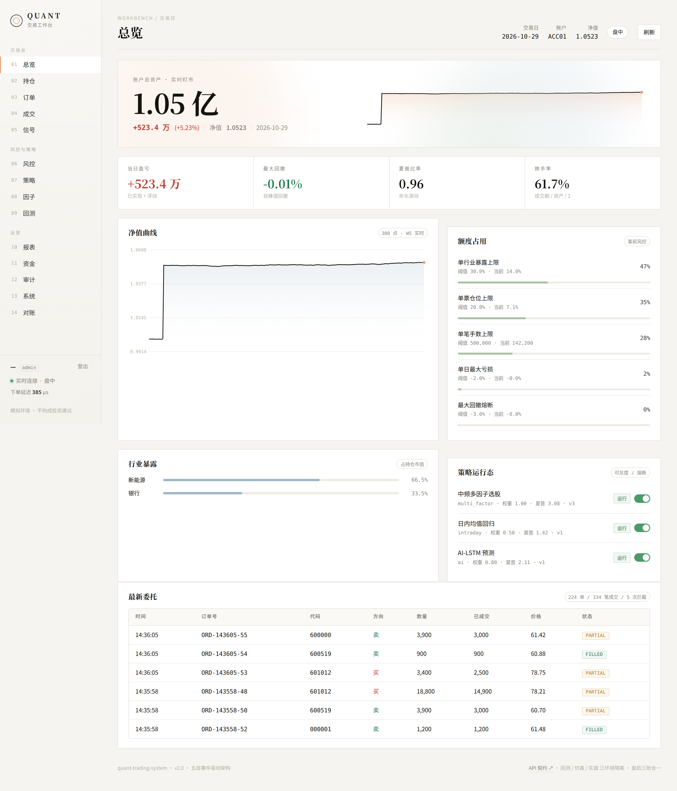
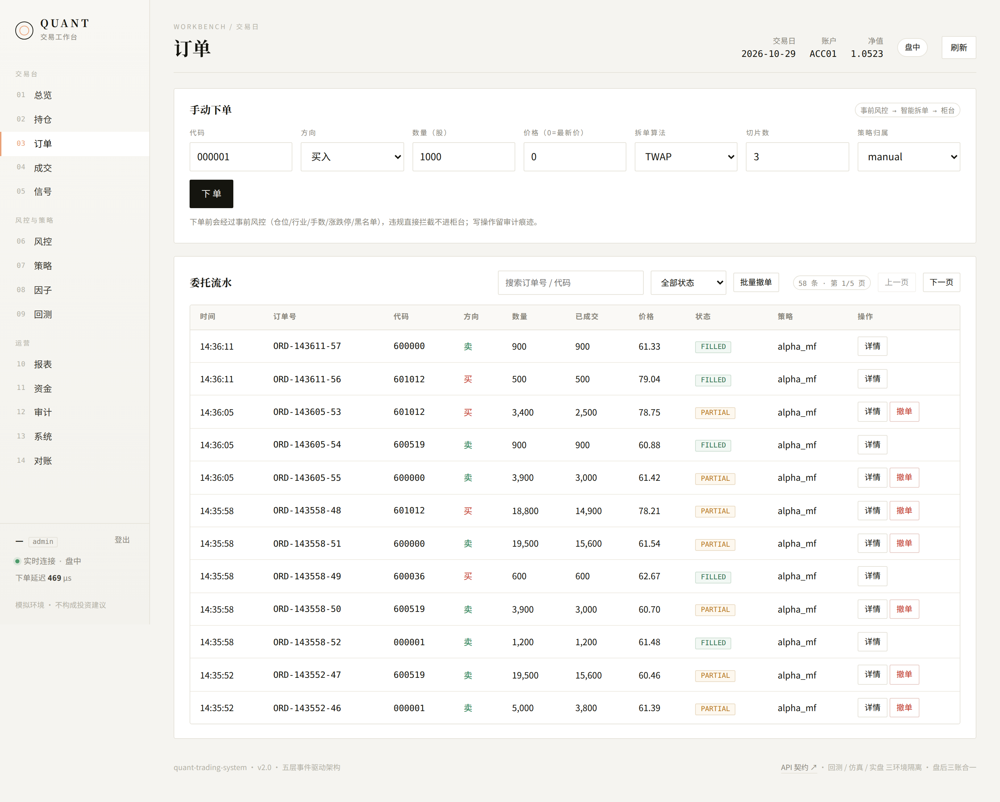
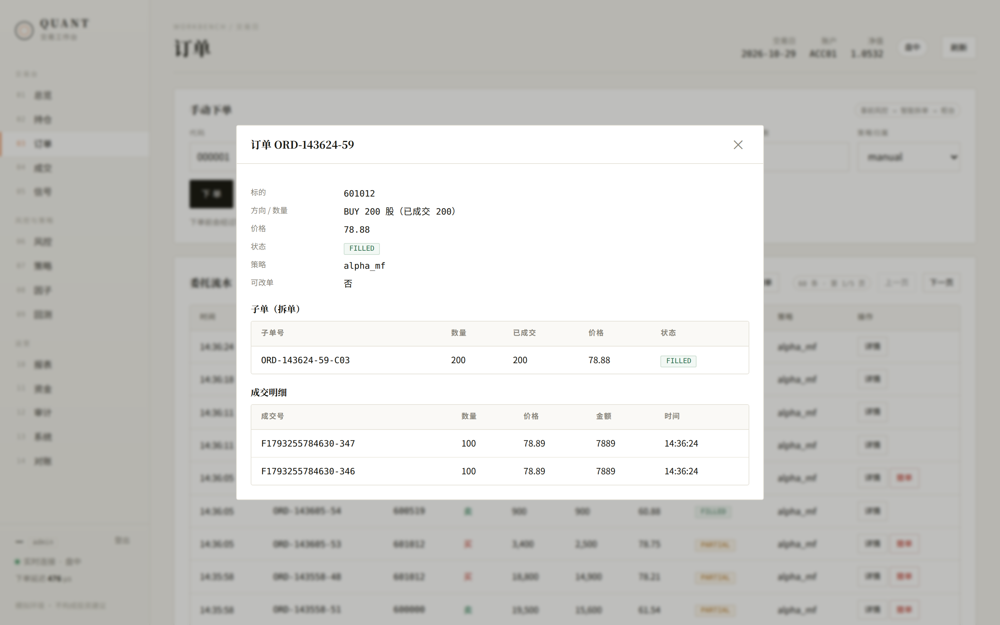
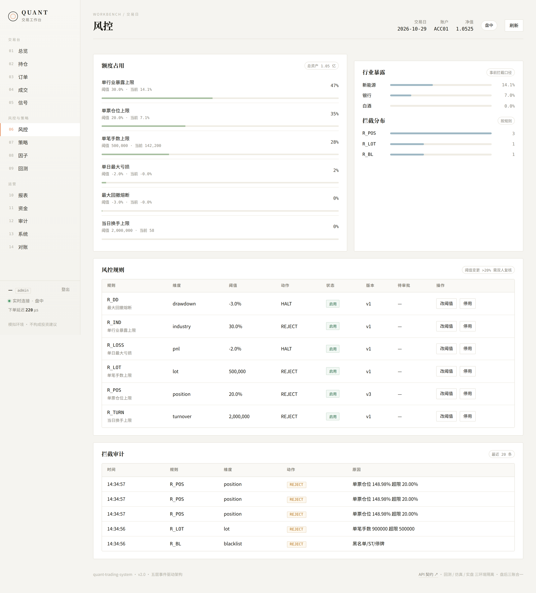
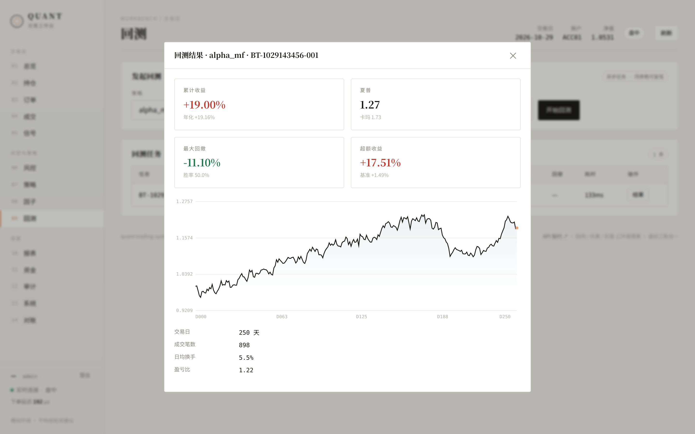
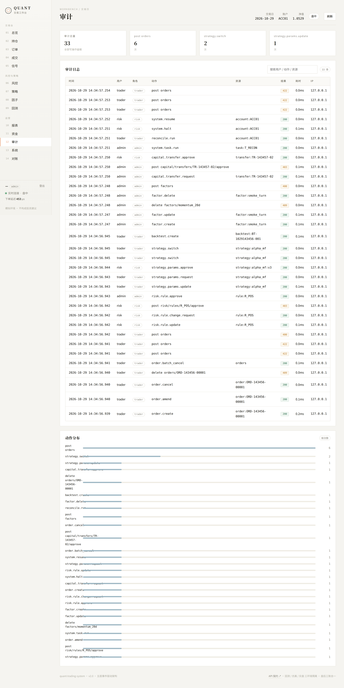
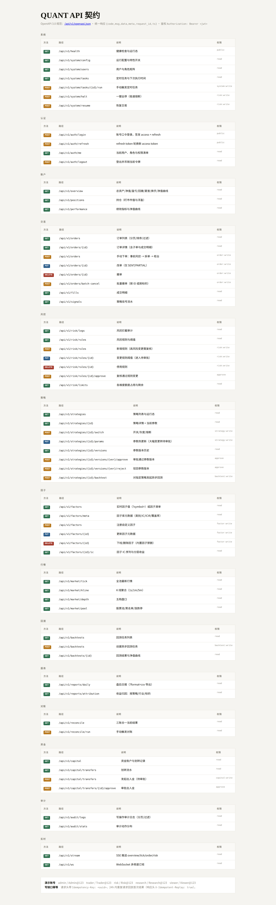

# quant-trading-system

> 工业级中高频量化交易系统 · 对标 **九坤 / 明汯 / 幻方** 私募标准
>
> 覆盖：业务需求 → 五层架构 → 技术栈 → DB + Redis 详细设计 → 全链路时序 → 矩阵式风控 → 部署方案 → 面试口述。
> 可直接用于 **后端面试、项目复盘、简历落地**。

[](https://go.dev)
[](https://python.org)
[](https://mysql.com)
[](https://redis.io)
[](https://kafka.apache.org)

---

## 一、系统一句话定位

面向 **A 股中高频 / 中频多因子 / 日内 T+0 / 套利 / AI 量化** 的全链路交易系统：数据工业化、因子工厂、AI 模型迭代、超低延迟执行、多层矩阵风控、**离线回测 → 仿真 → 实盘三环境隔离**。

> 九坤核心特点：数据工业化、因子工厂、AI 模型迭代、超低延迟执行、多层矩阵风控、三环境隔离。

---

## 二、五层架构总览

```
┌──────────────────────────────────────────────────────────────────────┐
│                          监控告警 / 归因 / 运维调度                      │
│               （延迟监控 · 夏普 · 最大回撤 · 因子收益拆解）               │
└──────────────────────────────────────────────────────────────────────┘
        ▲                ▲                 ▲                ▲
        │ 行情事件        │ 信号事件         │ 下单事件        │ 成交回执事件
        │ 风控日志        │                 │                │
┌───────┴────┐   ┌───────┴────┐   ┌────────┴─────┐   ┌───────┴─────┐   ┌──────────┐
│ 数据 中台层 │──▶│ 策略 引擎层 │──▶│  风控 引擎层  │──▶│ 交易 执行层  │──▶│ 资产 台账层 │
│ (Factor    │   │ (Signal    │   │ (Gate +     │   │ (Algo +     │   │ (Ledger + │
│  Factory)  │   │  Engine)   │   │  Monitor)   │   │  OMS)       │   │  PnL)     │
└────────────┘   └────────────┘   └──────────────┘   └──────────────┘   └──────────┘
   Kafka+Flink     Python+Go        Redis 预载规则      TWAP/VWAP        MySQL 强一致
   Redis 因子池    PyTorch/XGB      毫秒级拦截         订单状态机         盘后三账合一
   ClickHouse 时序 策略热更新        违规订单丢弃        柜台对接          审计可追溯
```

**核心通信范式**：`事件驱动 EDA + Kafka 事件总线 + Redis 低延迟缓存 + MySQL 强一致台账`。

---

## 三、目录结构

```
quant-trading-system/
├── README.md                  # 本文件：系统总览
├── docs/                      # 设计文档（面试 / 复盘核心）
│   ├── 01-architecture.md     # 五层架构与逐层详细设计
│   ├── 02-redis-design.md     # Redis 键设计 / 数据结构 / 最佳实践
│   ├── 03-mysql-design.md     # MySQL 表结构 + 完整 DDL 说明
│   ├── 04-sequence.md         # 全链路时序（盘前→盘中→盘后）
│   ├── 05-risk-system.md      # 矩阵式三层风控体系
│   ├── 06-deployment.md       # K8s 部署 / 三环境隔离 / 容灾
│   ├── 07-interview.md        # 1 分钟口述 + 高端追问
│   ├── 08-frontend-api.md     # 九坤官网拆解 + 前端设计 + 接口缺口清单
│   └── 09-api-complete.md     # 65 个接口全量落地：RBAC/幂等/限流/审计/审批
├── sql/
│   ├── 01_schema.sql          # MySQL 工业级建表（持仓/订单/成交/资金/风控/绩效）
│   └── 02_init_data.sql       # 初始化配置数据
├── go/                        # 实盘引擎（Go，低延迟）
│   ├── cmd/main.go            # CLI 编排：装配五层 + 端到端演示
│   ├── cmd/server/main.go     # 工作台服务：仿真循环 + HTTP/SSE + 静态托管
│   └── internal/
│       ├── common/            # 领域模型：Tick/Order/Signal/Position/PnL
│       ├── data/              # 数据中台：行情订阅 + 因子写入 Redis
│       ├── strategy/          # 策略引擎：多因子打分 + 信号聚合
│       ├── risk/              # 风控引擎：事前/事中/事后
│       ├── execution/         # 交易执行：拆单 + 订单状态机 + OMS
│       ├── ledger/            # 资产台账：MySQL 落地 + 盘后对账
│       └── api/               # 接口层（19 文件 / 65 路由）
│           ├── server.go      # 路由表 + 中间件链
│           ├── httpx.go       # 统一 envelope / 错误码 / 分页
│           ├── jwt.go         # 手写 HS256
│           ├── auth.go        # 登录 / RBAC 5 角色 9 权限
│           ├── ratelimit.go   # 令牌桶 + 幂等键
│           ├── audit.go       # 写操作审计
│           ├── store.go       # 参数版本 / 规则 / 因子库 / 划转 / 任务
│           ├── handlers_*.go  # 交易 / 风控 / 策略 / 因子 / 报表 / 系统
│           ├── ws.go          # 手写 RFC6455 WebSocket
│           └── openapi.go     # OpenAPI 3.0 + 自包含文档页
├── web/                       # 交易工作台前端（零依赖，原生 JS + Canvas）
│   ├── index.html             # 登录门禁 + 14 视图外壳
│   ├── style.css              # 九坤风格：近白底 / 超大衬线数字 / 低饱和撞色
│   └── app.js                 # REST + WebSocket + Canvas + 写操作
├── scripts/
│   └── smoke_test.py          # 端到端冒烟：61 项断言覆盖 14 个场景
└── python/                    # 研究平台（Python，因子/回测）
    ├── factors/               # 因子工厂：量价/基本面/AI 因子
    ├── strategies/            # 多因子选股 / 日内 / 套利
    ├── risk/                  # 风控规则（研究侧）
    └── backtest/              # 回测框架 + 绩效归因
```

---

## 四、核心非功能指标（私募硬标准）

| 指标 | 目标 | 实现手段 |
|------|------|----------|
| 行情延迟 | 微秒 ~ 毫秒 | C++/Go 直连行情，Redis 缓存盘口 |
| 信号生成 | 单策略毫秒级 | Go 实盘加速 + Redis 因子池热读 |
| 下单延迟 | 百微秒级 | 内存订单簿 + FIX/原生 API |
| 系统可用性 | 交易日 99.99% | K8s 多副本 + 主备柜台 |
| 风控生效 | 事前强拦截 / 零违规 | 规则预载 Redis，违规丢弃 |
| 数据一致性 | 行情/持仓/订单/资金强一致 | 柜台回执为真值，盘后三账合一 |
| 迭代效率 | 回测→实盘 1 天内 | 三环境共享代码，灰度 + 熔断 |

---

## 五、业务约束（A 股合规）

- 日内不能裸做空、涨跌停、T+1 → 适配 **合规拆单** 与 **黑白名单**。
- 单票仓位、行业集中度、单日最大亏损、回撤阈值 → **强约束**。
- 高频禁止大单冲击 → **智能分片 + 时间切片**。
- 所有策略 → **可灰度、可熔断、可一键关停**。

---

## 六、快速开始

```bash
# 1) Go 实盘引擎（编译校验）
cd go && go mod tidy && go build ./... && go run ./cmd

# 2) Python 研究平台（因子 + 回测）
cd python && pip install -r requirements.txt
python -m backtest.run --strategy multi_factor --start 20240101 --end 20240630

# 3) 建库
mysql -uroot -p quant < sql/01_schema.sql
mysql -uroot -p quant < sql/02_init_data.sql

# 4) 工作台 + 端到端冒烟
cd go && go run ./cmd/server -addr :8080 -web ../web &
python3 scripts/smoke_test.py
```

---

## 七、Web 交易工作台（九坤风格 + 全量接口）

设计语言借鉴九坤官网：**近白暖底 + 超大衬线数字 + 低饱和撞色 + 细线大留白**；
内容换成交易运维：总资产、净值曲线、额度占用、行业暴露、策略开关、下单与审批。



```bash
cd go && go run ./cmd/server -addr :8080 -web ../web
# 打开 http://localhost:8080   （接口文档：http://localhost:8080/api/v1/docs）
```

### 1. 演示账号（5 角色）

| 账号 | 口令 | 角色 | 能做什么 |
|------|------|------|----------|
| `admin` | `Admin@123` | 管理员 | 全权限 |
| `trader` | `Trader@123` | 交易员 | 下单/改撤单、策略开关与参数、回测 |
| `risk` | `Risk@123` | 风控官 | 规则变更、审批（参数/资金复核） |
| `research` | `Research@123` | 研究员 | 因子注册维护、回测 |
| `viewer` | `Viewer@123` | 只读 | 只看不改 |

### 2. 14 个视图

| 分组 | 视图 | 关键能力 |
|------|------|----------|
| 交易台 | 总览 / 持仓 / **订单** / 成交 / 信号 | 手动下单（风控→拆单→柜台）、订单详情、改单、撤单、批量撤单 |
| 风控与策略 | **风控** / **策略** / **因子** / **回测** | 额度占用、规则改阈值（双人复核）、参数版本审批、因子 CRUD + IC 分析、异步回测 + 净值曲线 |
| 运营 | 报表 / **资金** / **审计** / **系统** / 对账 | 日报与归因（CSV 导出）、出入金审批、审计追溯、任务触发、一键熔断 |

### 3. 接口与治理

**65 个接口**（GET 39 / POST 19 / PUT 4 / DELETE 3），全部带：

- **统一 envelope**：`{code,msg,data,meta,request_id,ts}`，风控拦截单独用 422 + `code=1007`
- **JWT + RBAC**：HS256 手写实现，5 角色 9 权限，写接口逐个声明所需权限
- **幂等**：写接口带 `Idempotency-Key`，24h 内重放首次结果（网络抖动不会重复下单）
- **限流**：令牌桶读写分离（读 80 rps / 写 8 rps），防策略异常刷单打挂柜台
- **审计**：所有写操作留痕（用户/角色/IP/耗时/request_id/详情），可查可导出
- **双人复核**：风控规则放宽 >20%、策略参数变动 >30%、出入金 —— 提交人不能自审

完整清单、权限矩阵、WebSocket 协议见 **[docs/09-api-complete.md](docs/09-api-complete.md)**；
前端设计转译与九坤官网拆解见 **[docs/08-frontend-api.md](docs/08-frontend-api.md)**。

### 4. 效果

| | |
|---|---|
|  |  |
|  |  |
|  |  |

### 5. 测试

```bash
# 单元测试（含接口层：JWT/RBAC/幂等/限流/审批流/分页）
cd go && go test ./...

# 端到端冒烟：61 项断言，14 个场景
python3 scripts/smoke_test.py
#   通过 61 / 失败 0
```

---

## 八、与普通业务系统的本质区别（面试绝杀）

| 系统 | 一致性 | 核心矛盾 | 延迟诉求 |
|------|--------|----------|----------|
| IM | 最终一致 | 消息扩散 | 中 |
| 电商 | 强一致 | 库存防超卖 | 中 |
| 量化 | **盘中允许毫秒级不一致，盘后强对账** | 冲击成本 / 滑点 / 对抗市场 | **极致低延迟优先** |

> 量化系统：**低延迟优先于一致性**（盘中），**一致性兜底于台账**（盘后）。多层风控**不可逆拦截**，离线→仿真→实盘**严格隔离**。

---

## 九、License

MIT · 仅用于学习与面试复盘，实盘须接入合规柜台与风控。
